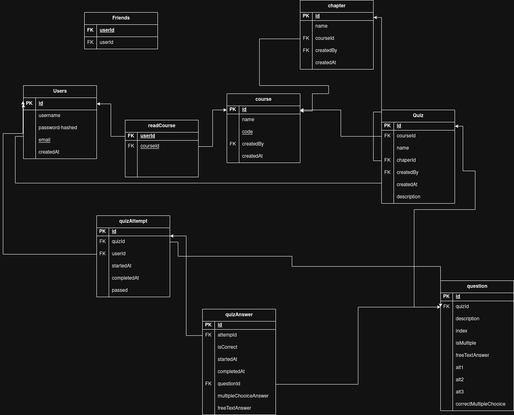

# Project Specification

Our goal is to create an engaging, gamified learning platform where users can track their progress, compete with friends, and improve their knowledge through community-driven study materials. The platform will allow users to create accounts, save courses, share study questions, and get feedback on their weak points. Additional AI-powered features for question generation may be explored if time permits.

## Features
- Gamify learning coursework
- Each user should be able to create an account and save his/hers courses.
- Community-driven study site where users can upload and share study questions.
- Add friends, have leadersboards, compete with eachother
- Get feedback and practice your weakpoints.

## Extra features (if time)
- Add a 1v1 or (1v1v1... limited to 10 users) gamemode, where users compete against each other in a fast-paced. Quickest to anser x amount of questions correctly wins.
- Use AI models to classify/generate questions for different subjects, e.g from pdfs.
- Add resources tab for each courses that points to useful course resources.

# Technical Specification

## Frontend
- Next.js with TypeScript for a modular, scalable frontend. 
- Tailwind CSS will provide a clean, responsive UI.
- The frontend will communicate with the backend via REST APIs
- Node.js may be used for some minor additional services.

## Backend
- The backend will be built with Django and Django REST Framework, handling user authentication, data storage, and API endpoints.
- The database will be SQL-based since the application involves user accounts, courses, study questions, leaderboards, and progress tracking—all of which fit well into a structured relational model with clear relationships. 
- If a 1v1 gamemode is created django channels will also be used, to connect players and update scores in real time.
- AI-based question generation (if implemented) will run as a separate background service, probably based on the smallest deepseek model.

## Videos
[Shared folder where all videos should be placed](https://liuonline-my.sharepoint.com/:f:/g/personal/gusca083_student_liu_se/Euvmb9LMRQVCo_nC66BhpaUBa7UWBu0_i2WRECPeUsJULQ?e=1BtRIg)

[Group Project Overview](https://liuonline-my.sharepoint.com/personal/gusca083_student_liu_se/_layouts/15/stream.aspx?id=%2Fpersonal%2Fgusca083%5Fstudent%5Fliu%5Fse%2FDocuments%2FVideos%2F2025%2D05%2D23%2000%2D27%2D13%2Emkv&referrer=StreamWebApp%2EWeb&referrerScenario=AddressBarCopied%2Eview%2E8778fecf%2D87a5%2D47f5%2D8897%2D34b556a9dfa1)

[Gustav Screen Cast (gusca083)](https://liuonline-my.sharepoint.com/:v:/g/personal/gusca083_student_liu_se/EQ9_UUFWUWxPvfSNlzswcC0BmOe5CCV6vjgK1j6kwDtgmg?nav=eyJyZWZlcnJhbEluZm8iOnsicmVmZXJyYWxBcHAiOiJPbmVEcml2ZUZvckJ1c2luZXNzIiwicmVmZXJyYWxBcHBQbGF0Zm9ybSI6IldlYiIsInJlZmVycmFsTW9kZSI6InZpZXciLCJyZWZlcnJhbFZpZXciOiJNeUZpbGVzTGlua0NvcHkifX0&e=mLuVJd)

[Rickard Screen Cast (ricel947)](https://liuonline-my.sharepoint.com/personal/gusca083_student_liu_se/_layouts/15/stream.aspx?id=%2Fpersonal%2Fgusca083%5Fstudent%5Fliu%5Fse%2FDocuments%2FVideos%2Fricel946%5Fscreencast%2Emkv&referrer=StreamWebApp%2EWeb&referrerScenario=AddressBarCopied%2Eview%2E0bfd765b%2D9505%2D454a%2Db32f%2D0baf5a3cf9b4)

[Thea Screen Cast (thean981)](https://liuonline-my.sharepoint.com/personal/gusca083_student_liu_se/_layouts/15/stream.aspx?id=%2Fpersonal%2Fgusca083%5Fstudent%5Fliu%5Fse%2FDocuments%2FVideos%2Fthea%5Findividal%5Fcode%5Freview%2Emp4&referrer=StreamWebApp%2EWeb&referrerScenario=AddressBarCopied%2Eview%2E5c45a325%2Dd137%2D4647%2D8036%2D7c0e8bee6bdd)
